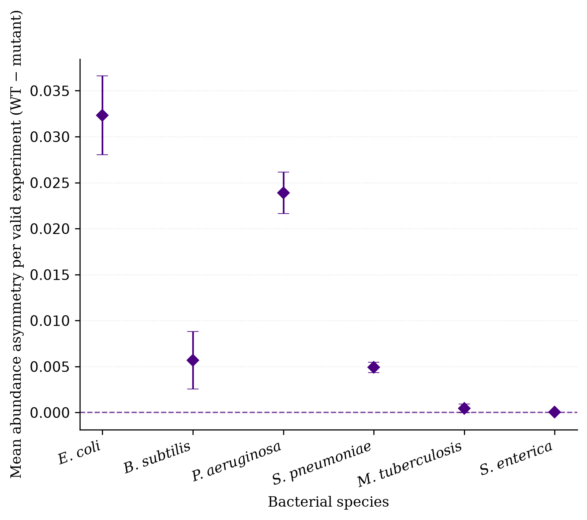
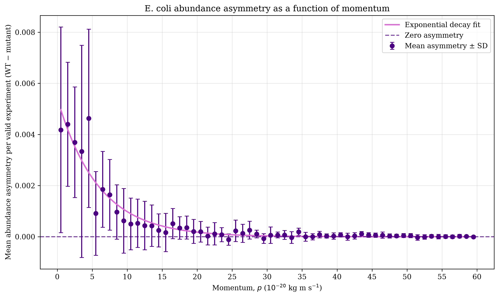
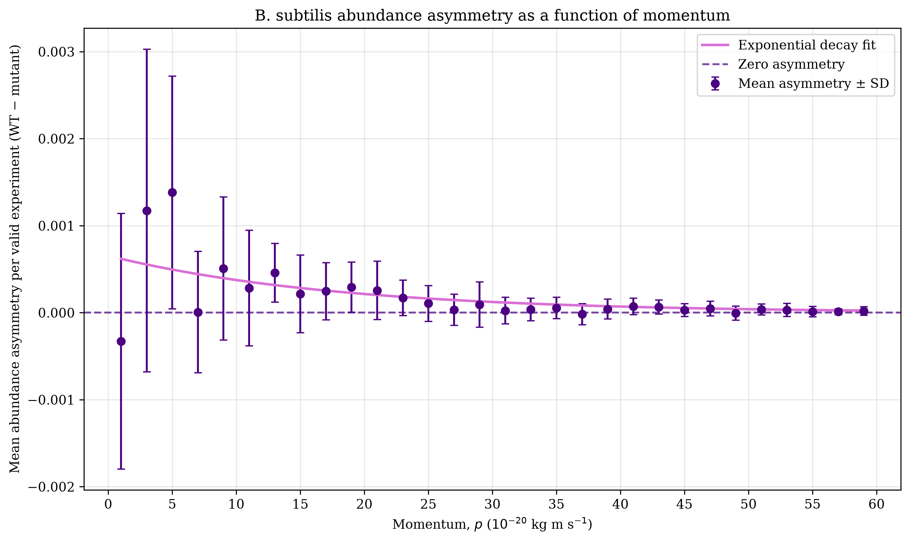
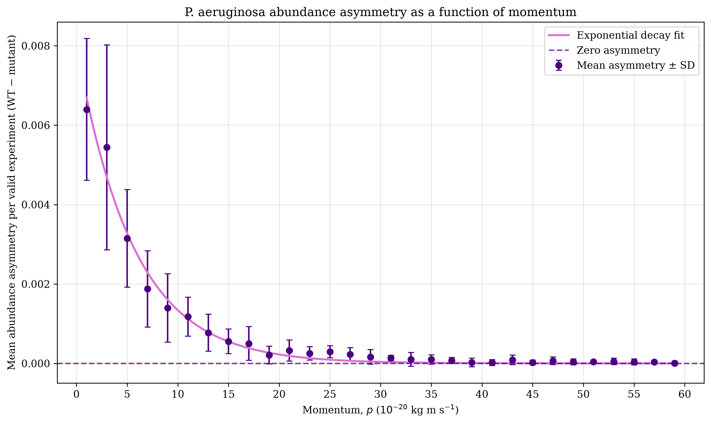
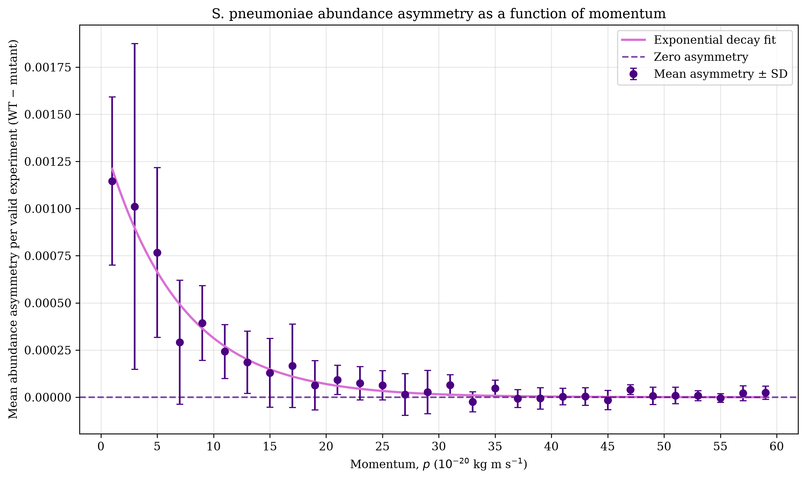
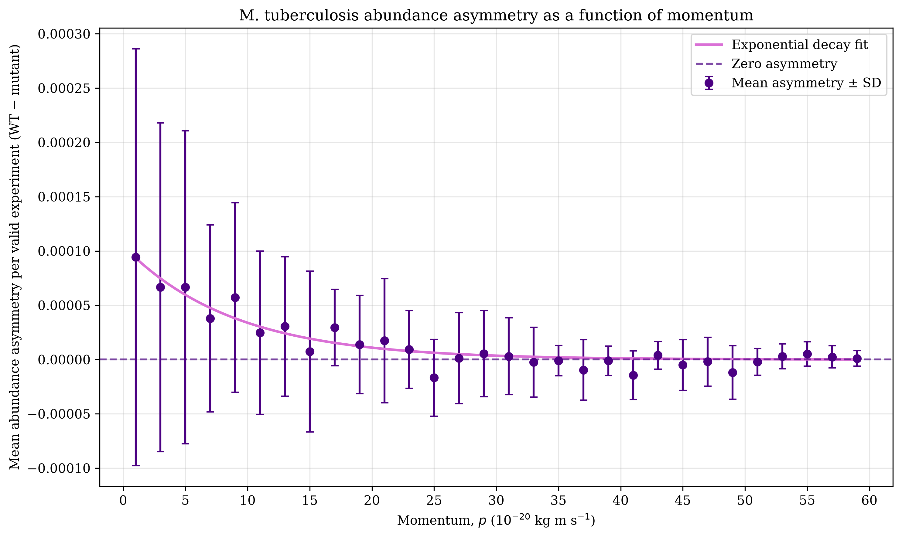
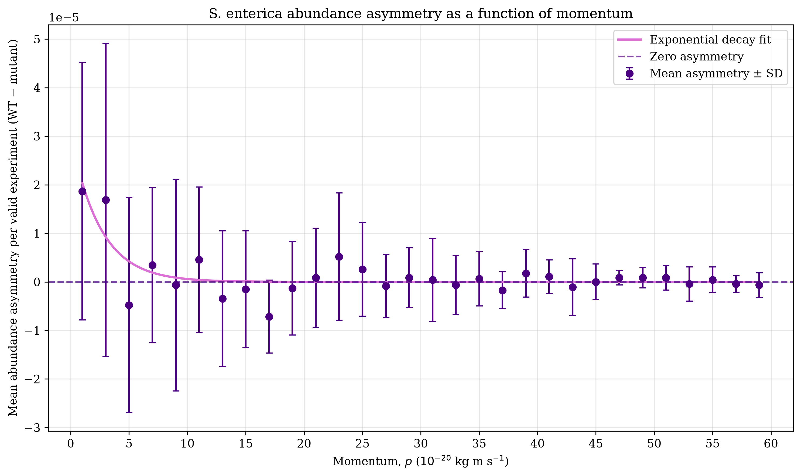

# Bacterial Population Analysis 
This project analyzed simulated data from a bacterial tracking experiment under specific nutrient and stress conditions.

## Table of Contents
- [Research Questions 🔎](#question)
- [Dataset 🧫](#dataset)
- [Methods 💻](#methods)
- [Results 📊](#results)
- [Conclusions 🎯](#conclusions)
- [Usage Instructions 📚](#instructions)

## Research Questions 
The aim of this project was to quantify the abundance of wild-type and mutant bacterial strains and and investigate how the differences in their abundance vary with momentum. The following research questions were addressed: 
1. What is the average abundance of each bacterial strain, and what is the associated statistical uncertainty?
2. Is there a statistically significant abundance asymmetry between the wild-type and mutant strains?
3. Is there a statistically significant asymmetry between the wild-type and mutant strains as a function of their momentum? 

## Dataset 
The dataset consists of 10 simulated bacterial tracking file (`output-Set1.txt` to `output-Set10.txt`), each containing 500,000 experiments. `output-Set0.txt` was excluded from the analysis. The dataset can be accessed [here](https://surfdrive.surf.nl/index.php/s/7udCnWTk4yMUASD). Each file consists of multiple experiments. Each experiment begins with a header containing the experiment code and the number of bacteria recorded in that experiment. Each row contains the three-dimensional momentum components (`px`, `py`, and `pz`) and the ID of the corresponding bacterial strain. Twelve bacterial IDs are included in the dataset, representing six bacterial species with a wild-type and mutant strain for each species.

<b>View bacterial strain IDs</b>

 

| ID | Bacterial species | Strain |
|---:|---|---|
| 211 | *E. coli* | Wild type |
| -211 | *E. coli* | Mutant |
| 321 | *B. subtilis* | Wild type |
| -321 | *B. subtilis* | Mutant |
| 2212 | *P. aeruginosa* | Wild type |
| -2212 | *P. aeruginosa* | Mutant |
| 3122 | *S. pneumoniae* | Wild type |
| -3122 | *S. pneumoniae* | Mutant |
| 3312 | *M. tuberculosis* | Wild type |
| -3312 | *M. tuberculosis* | Mutant |
| 3334 | *S. enterica* | Wild type |
| -3334 | *S. enterica* | Mutant |

## Methods 
### Average Bacterial Counts
For each of the 10 data files, the average bacterial count per experiment was calculated separately for each bacterial ID. Invalid experiments were excluded from the analysis. **An experiment was considered valid if it contained at least one of the 12 studied bacterial IDs.** For each bacterial ID, the total bacterial count within a batch (file) was divided by the number of valid experiments in that batch (file). This resulted in 10 independent batch averages for each bacterial ID.

### Final Average Abundance
The final average count for each bacterial ID was calculated as the arithmetic mean of the 10 batch averages. A weighted average accounting for the different numbers of valid experiments in each batch was also calculated; however, no significant difference was found when compared to the arithmetic average. Consequently, the arithmetic mean was used for further analysis. Statistical uncertainties were estimated using subsampling. For each bacterial ID, the standard deviation of the 10 batch averages was calculated and used as the uncertainty of the final average.

### Difference in Abundance between Wild Type and Mutant
The asymmetry between the wild-type and corresponding mutant strain was quantified as the difference in their final average counts:

$$\text{Asymmetry} = \overline{N}_{WT} - \overline{N}_{mutant}$$

The uncertainty of the asymmetry was also estimated using subsampling. For each bacterial species, the wild-type and mutant batch averages were subtracted separately, producing 10 differences. The standard deviation of these 10 differences was used as the uncertainty of the final asymmetry per each bacterial ID pair.

### Momentum Asymmetry 
For each valid bacterial entry across all 10 files, the total momentum was calculated from its three components ($p_x$, $p_y$, $p_z$).  

$$p = \sqrt{p_x^2 + p_y^2 + p_z^2}$$

Momentum values were grouped into bins to create one histogram per strain per ID. A momentum range of 0–60 was used, which covered 99.99% of momenta values. A bin width of 1 was used for *E. coli* which had a substantially higher abundance than all the other species, for which a bin width of 2 was used. For each file, abundance asymmetry was calculated by subtracting mutant counts from wild-type counts in each corresponding momentum bin. The resulting differences were normalized by the number of valid events in that file. The mean normalized asymmetry and sample standard deviation were then calculated across the 10 subsamples for each momentum bin. Finally, an exponential function was fitted to the mean asymmetry as a function of bacterial momentum. 
$$A(p) = A_0 e^{-kp}$$

## Results 
### Average Bacterial Counts 
**Table 1.** The average bacterial counts per experiment and their statistical uncertainties. Uncertainties represent the standard deviation of the 10 batch averages obtained by subsampling.

| Bacterial species | Strain | Average count per event ± SD |
|---|---|---:|
| *E. coli* | Wild type | 19.964 ± 0.031 |
| *E. coli* | Mutant | 19.932 ± 0.030 |
| *B. subtilis* | Wild type | 2.5110 ± 0.0045 |
| *B. subtilis* | Mutant | 2.5053 ± 0.0052 |
| *P. aeruginosa* | Wild type | 1.2089 ± 0.0018 |
| *P. aeruginosa* | Mutant | 1.1850 ± 0.0023 |
| *S. pneumoniae* | Wild type | 0.2768 ± 0.0010 |
| *S. pneumoniae* | Mutant | 0.27189 ± 0.00093 |
| *M. tuberculosis* | Wild type | 0.03947 ± 0.00027 |
| *M. tuberculosis* | Mutant | 0.03903 ± 0.00038 |
| *S. enterica* | Wild type | 0.001188 ± 0.000040 |
| *S. enterica* | Mutant | 0.001152 ± 0.000048 |

### Abundance Asymmetry

**Figure 1.** Visual representation of differences in bacterial abundance (wild type − mutant). Error bars represent the uncertainty obtained from the standard deviation of the 10 subsample differences.

**Table 2.** Differences in bacterial abundance (wild type − mutant). Uncertainties obtained from the standard deviation of the 10 subsample differences.

| Bacterial species | Mean abundance asymmetry | Standard deviation |
|---|---:|---:|
| *E. coli* | 0.0323 | 0.0043 |
| *B. subtilis* | 0.0057 | 0.0031 |
| *P. aeruginosa* | 0.0239 | 0.0023 |
| *S. pneumoniae* | 0.00491 | 0.00055 |
| *M. tuberculosis* | 0.00044 | 0.00046 |
| *S. enterica* | 0.0000355 | 0.0000651 |

### Asymmetry as a Function of Momentum
<table>
  <tr>
    <td width="50%">
      
      
<b>A.</b> <i>E. coli</i>

    </td>
    <td width="50%">
      
      
<b>B.</b> <i>B. subtilis</i>

    </td>
  </tr>
  <tr>
    <td>
      
      
<b>C.</b> <i>P. aeruginosa</i>

    </td>
    <td>
      
      
<b>D.</b> <i>S. pneumoniae</i>

    </td>
  </tr>
  <tr>
    <td>
      
      
<b>E.</b> <i>M. tuberculosis</i>

    </td>
    <td>
      
      
<b>F.</b> <i>S. enterica</i>

    </td>
  </tr>
</table>

**Figure 2.** Mean normalized abundance asymmetry (wild type − mutant) as a function of momentum for six bacterial species (A–F) with fitted exponential curves. Error bars represent the standard deviations across the 10 subsamples.  

***Note:** The numerical values for asymmetries as a function of momentum are stored in `momentum_asymmetry_results.csv` in this repository.*

## Conclusions 
**Table 3.** Statistical significance of abundance asymmetries (wild type − mutant).
| Bacterial species | Mean asymmetry / SD |
|---|---:|
| *E. coli* | 7.5σ |
| *B. subtilis* | 1.8σ |
| *P. aeruginosa* | 10.6σ |
| *S. pneumoniae* | 8.9σ |
| *M. tuberculosis* | 1.0σ |
| *S. enterica* | 0.5σ |

Using a threshold of 3σ, a statistically significant abundance asymmetry between wild type and mutant was concluded for *E. coli*, *P. aeruginosa*, and *S. pneumoniae*. 

When looking at the asymmetry as a function of bacterial momentum, the only statistically significant difference between wild type and mutant was found for *P. aeruginosa* at momentum interval $0 \leq p < 2 \times 10^{-20}\ \mathrm{kg\,m\,s^{-1}}$ ($\sigma = 3.6$).

## Usage Instructions 
### Requirements 
The analysis requires **Python 3**, **NumPy**, and **Matplotlib**. 

macOS installation: 
`python3 -m pip install numpy matplotlib`

Windows installation: 
`py -m pip install numpy matplotlib`

Linux installation: 
`apt-get install python3-tk`
`python3 -m pip install numpy matplotlib`

***Note:** The complete dataset is approximately **8 GB.** Ensure that sufficient storage space is available before downloading the files.*

### Running the Analysis 
1. Download the 10 data files (`output-Set1.txt` to `output-Set10.txt`). Data files can be accessed [here](https://surfdrive.surf.nl/index.php/s/7udCnWTk4yMUASD). 
2. Download `abundance.py` and `momentum.py` from this repository.
2. Make sure that the code and all 10 data files are located in the same directory.
3. Run the analysis. 

The script processes all 10 data files and calculates the mean bacterial abundance for each strain, along with its statistical uncertainty. It also computes the abundance asymmetry between wild-type and mutant strains, including the corresponding uncertainty, and investigates how this asymmetry varies as a funciton of bacterial momentum. The script also generates the plot to visualize the results.
